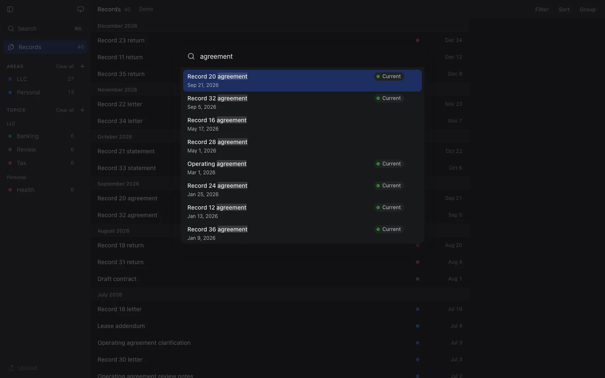

<p align="center">
  
</p>

<h1 align="center">Papermint</h1>

<p align="center">An installable frontend for your self-hosted Paperless-ngx archive.</p>

Papermint gives your documents a focused workspace. Search from the keyboard, review a document side by side with the list, or file something new from your phone. Paperless-ngx handles storage, OCR, search, and permissions through its REST API.



- **Find a record.** Press <kbd>⌘</kbd> / <kbd>Ctrl</kbd> + <kbd>K</kbd> or <kbd>/</kbd> to search titles and document text. Filter by date, file type, status, area, and topic.
- **Read and file.** Preview a record beside the list on desktop or in a sheet on mobile. Upload through the picker or drag and drop, then file a new record or attach it as a version.
- **Keep track of versions.** Separate drafts from current records and follow links to replacements. Download originals directly from Paperless.
- **Install it.** Add Papermint to your home screen or desktop. A limited document index remains available offline.

## Try the demo

[Open the live demo](https://papermint.hobbyhood.app/). Browse, search, filter, and download sample records in a read-only archive that updates from the `main` branch.

## Try it locally

With Node.js 24 LTS and npm installed, run these commands from the repository root.

```sh
npm ci
npm run demo
```

Open [http://127.0.0.1:4673](http://127.0.0.1:4673). The demo uses synthetic documents and keeps changes in memory. Restart it to reset the sample archive.

## Connect your archive

Papermint was developed against **Paperless-ngx 3.4.2**. Serve the built frontend and the authenticated Paperless API on the same HTTPS origin. The [deployment guide](DEPLOY.md) has an Nginx example, setup checks, and the runtime configuration reference.

Documents without a status tag show up under **Current** by default. Papermint uses your existing Paperless tag hierarchy for areas and topics. Add status tags if you want a drafting workflow and a document-link field if you want to connect replacement records. An optional `config.json` lets you change the default status, name the replacement field, and link to files your deployment protects.

## Work on Papermint

Papermint uses Preact, TypeScript, and Vite. Start in `src/api` for Paperless requests, `src/domain` for document and tag rules, `src/state` for workflows, or `src/mobile` for phone layouts. `src/data` and `src/pwa` handle the local index and app shell.

```sh
npm run check                # TypeScript, ESLint, Prettier, and unit tests
npx playwright install chromium
npm run test:e2e             # Desktop, mobile, and installed app on synthetic data
```

Keep behavior consistent across screen sizes and preserve the position of content as it loads. The lint rules cap source files at 800 lines, cyclomatic complexity at 20, and block nesting at 3.

## License

Papermint is [MIT licensed](LICENSE) and is an independent frontend for [Paperless-ngx](https://github.com/paperless-ngx/paperless-ngx). The repository includes third-party license notices.
